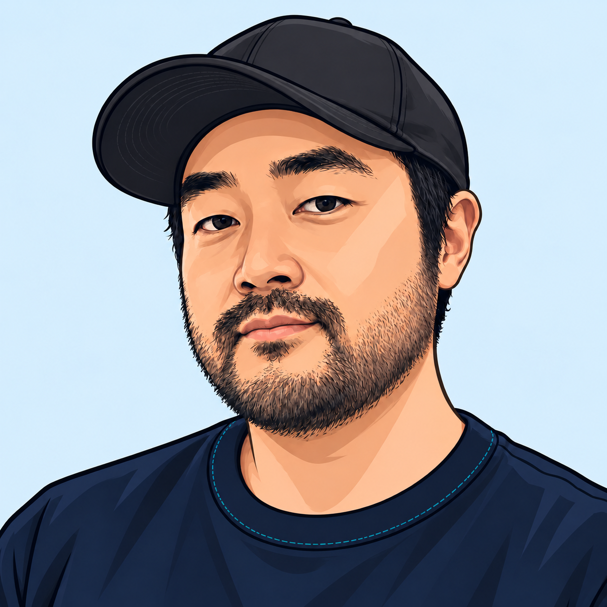

  
  <h1>안녕하세요, Ersione입니다.</h1>
  
생활 속 작은 불편과 호기심을 웹 서비스로 만듭니다. 만들고, 써보고, 다듬는 과정을 좋아합니다.

  
<a href="https://studio.ersione.com/"><strong>작은 3D 작업실 들어가기 →</strong></a>

### 만들고 있는 것들

| 프로젝트 | 소개 | 링크 |
| --- | --- | --- |
| **PogoAtlas** | 포켓몬 GO 도감 · 레이드 · 배틀 순위 | [서비스](https://pogo.ersione.com) · [코드](https://github.com/ersione/pogo-atlas-web) |
| **Company Lens** | 공개 고용 데이터로 살펴보는 회사와 업종의 변화 | [서비스](https://companylens.ersione.com) · [코드](https://github.com/ersione/company-lens) |
| **Ersione Design System** | 프로젝트를 잇는 UI 컴포넌트와 컬러 팔레트 | [컴포넌트 보기](https://ersione-design-system.ersione.chatgpt.site/) · [코드](https://github.com/ersione/ersione-design-system) |
| **Ersione’s Studio** | 프로젝트와 작은 게임이 쌓이는 3D 작업실 | [작업실](https://studio.ersione.com/) · [코드](https://github.com/ersione/ersione-studio) |

### 주로 사용하는 도구

TypeScript · React · Next.js · Go · SQLite

작은 도구부터 직접 운영하는 서비스까지, 필요한 것을 하나씩 만들어 갑니다.
