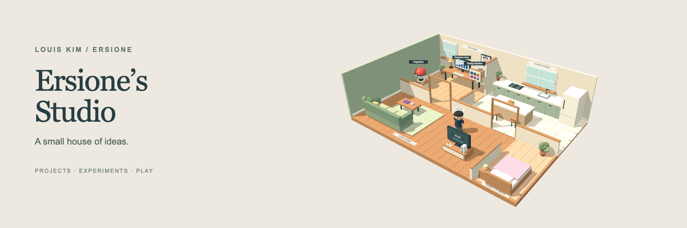

# Louis Kim

**Backend & Platform Engineer**

복잡한 시스템을 이해하고, 안정적으로 운영할 수 있는 구조를 만듭니다. 
온라인에서는 **Ersione**라는 이름으로 서비스를 만들고 기록합니다.

[홈페이지](https://ersione.com) · [이력서](https://resume.ersione.com) · [블로그](https://blog.ersione.com)

### Ersione’s Studio

만들고, 운영하고, 기록하는 작은 작업실.

**[작업실 들어가기 →](https://studio.ersione.com)** 
방마다 담긴 프로젝트를 둘러보고, 잠깐 게임도 즐겨보세요.

### 작업실에서 만드는 것들

| 🎮 PogoAtlas | 🔎 Company Lens | 🎨 Design System |
| --- | --- | --- |
| 포켓몬 GO를 더 즐겁게 | 공개 데이터로 들여다보는 회사 | 여러 프로젝트가 공유하는 UI |
| 도감·레이드·배틀 순위를 한곳에 모았습니다. | 회사와 업종의 고용 변화를 살펴봅니다. | 디자인 토큰·React 컴포넌트·테마를 관리합니다. |
| [서비스 열기 ↗](https://pogo.ersione.com) | [서비스 열기 ↗](https://companylens.ersione.com) · [코드](https://github.com/ersione/company-lens) | [컴포넌트 둘러보기 ↗](https://ersione-design-system.ersione.chatgpt.site/) · [코드](https://github.com/ersione/ersione-design-system) |

### 작업대 위의 최근 소식

**만든 것**

<!-- releases:start -->
- [Ersione Design System · v0.5.1](<https://github.com/ersione/ersione-design-system/releases/tag/v0.5.1>)
<!-- releases:end -->

**기록한 것**

<!-- posts:start -->
- [Audit Event에서 AI 챗봇까지](<https://blog.ersione.com/software-architecture/from-audit-events-to-ai-chatbot>)
- [메달리온 데이터 위에 Text-to-SQL과 RAG 올리기](<https://blog.ersione.com/software-architecture/adding-text-to-sql-and-rag-on-medallion-data>)
<!-- posts:end -->

[글 더 읽기 →](https://blog.ersione.com)
